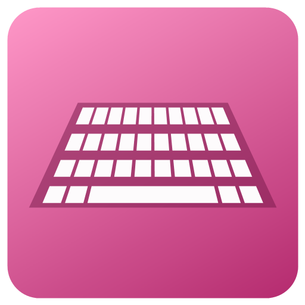

# PressViewer

<p align="center">
  
</p>

**PressViewer** 是一个 Windows 桌面输入统计工具，用热力图把「键盘、鼠标、手柄」的使用情况画出来：哪些键按得多、左键还是右键用得多、手柄哪个键被磨得最狠，一眼就能看到。

所有数据只写在本机的 `data/` 目录里，不联网、不上传。

> 本项目是 [xuhk/XAssistant](https://github.com/xuhk/XAssistant) 的 fork。
> 1.0.0 / 1.0.1 由原作者 **xuhk** 完成；1.1.0 起由 **Shuuki** 维护，做了更名、真实图形热力图、手柄统计、主题系统与设置页。
> 原版权声明与 MIT 许可文本保留在 [LICENSE](LICENSE)。

## 功能

**热力图**
- 104 键 ANSI 键盘热力图，按键次数直接写在键帽右下角，颜色按次数映射（对数刻度），0 次不着色。
- 立体鼠标图形：左键 / 滚轮 / 右键分别着色，滚轮上显示中键次数，位数多时自动折行。
- 手柄按键分区图：肩键、双摇杆、ABXY、十字键、Back / Start 各自成键，按 XInput 键位映射。
- 三种图形各自独立计算刻度，不会因为键盘按得多而让鼠标全是白色。
- 时间范围：总计、今日、昨天、前天、近七天、近三十天，或自选起止日期。
- 窗口最大化时键盘自动放大；键盘、鼠标、手柄同屏显示。

**记录**
- 键盘按键记录：总计 / 今天 / 昨天 / 前天 / 自选日期，可按默认顺序或次数排序。
- 鼠标点击记录：左中右累计、当日、任意历史日期。
- 手柄按键记录：累计、今日、任意历史日期。
- 电脑使用时长与软件使用时长（由后台服务采集，连续 10 分钟无输入即暂停计时）。
- 低层键盘 / 鼠标钩子 + XInput 轮询，程序启动即开始记录，采集异常会重试并写日志。

**界面**
- 12 套主题色（薄荷汽水、极光幻彩、深海蓝调、落日熔金、森林秘语、香槟鎏金、薰衣梦境、樱花轻语、青碧如洗、珊瑚晚霞、石墨夜色、七彩虹光），热力色带跟随主题。
- 深色 / 浅色模式，主题色与深浅色可以自由组合。
- 所有计数显示为带千分位的完整数字，按键上的数字超出边框会自动缩小字号。
- 独立的应用日志页、设置页。

## 下载与运行

1. 到 [Releases](https://github.com/KaibuchiShuuki/PressViewer/releases/latest) 下载 `PressViewer-1.1.2-win-x64.zip`（自包含 .NET 10，不需要额外安装运行时）。
2. 解压到任意目录（例如 `D:\soft\PressViewer`）。
3. 运行 `PressViewer.exe`。**程序需要管理员权限**，启动时会出现一次 UAC 提示；同意后首次启动会在程序目录下创建 `data/`，并从旧版本（XAssistant / PressViewer）的 `%APPDATA%` 复制已有记录。

开机自启、关闭行为（最小化到托盘 / 直接退出）、自动开始监测，都在「设置」页里。开了开机自启之后走的是登录计划任务，以最高权限静默启动，不会再弹提示。

> 为什么要管理员权限：键盘、鼠标的全局钩子受系统的权限隔离（UIPI）限制，普通权限进程收不到更高权限进程的输入。而《绝区零》《原神》这类游戏的可执行文件本身就声明了 `requireAdministrator`，不提权就完全记录不到游戏内的操作。

## 数据与隐私

- 数据目录：**程序目录下的 `data/`**（例如 `D:\soft\PressViewer\app\data`）
  - `key_data.db`、`click_data.db`、`gamepad_data.db`、`app_usage.db`
  - `appsettings.json`、`logs/`
- 每次按键或点击都会记录一行明细。历史数据可以在「设置 → 数据 → 压缩今天之前的数据」里合并成按天汇总，体积能明显缩小，统计数字不变。
- 不包含任何网络请求；除「检查更新」会读取本仓库的 GitHub Releases 外，不访问网络。
- `data/`、`*.db`、`logs/` 已写进 `.gitignore`，不会进入版本库。
- 想清空记录：退出程序后删除 `data/` 里对应的 `.db` 文件即可。

## 系统要求

- Windows 10 2004 及以上 / Windows 11，64 位。
- 自包含包无需安装 .NET；从源码构建需要 .NET SDK 10。

## 从源码构建

```powershell
dotnet build PressViewer.csproj -c Release
dotnet publish PressViewer.csproj -c Release -r win-x64 --self-contained true -o ..\app
```

后台的「电脑使用统计」服务在 `XAssistant.Service/` 目录，安装方式见该目录下的脚本；主程序不依赖它也能运行，只是「电脑使用统计」页会没有数据。

## 已知限制

- **Fn 键**：多数键盘的 Fn 由键盘固件处理，不经过操作系统，因此无法统计；热力图上固定显示 0。
- **Share / Guide**：XInput 不暴露这两个键，手柄图上不显示。
- 手柄只跟踪第一个已连接的 XInput 设备；DS4 / Switch Pro 等非 XInput 手柄需要系统层映射（如 Steam Input）后才能被识别。
- 仅支持 Windows。

## 致谢与许可

- 原始项目：[xuhk/XAssistant](https://github.com/xuhk/XAssistant)，作者 xuhk。
- 本项目遵循 [MIT License](LICENSE)，保留原版权声明。
- 图标与界面由本项目重新设计。
